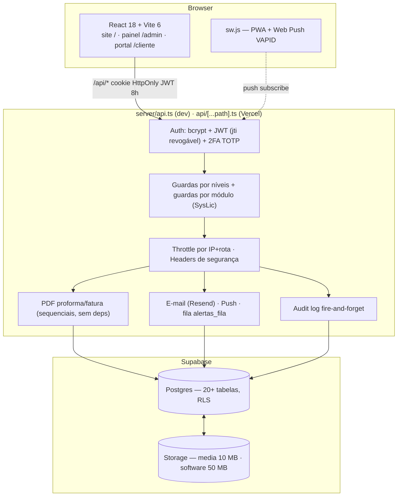
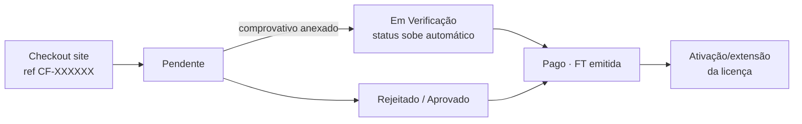

<div align="center">

# CFTEC — Plataforma Comercial B2B

**Site React + Painel multi-nível + Portal do cliente · Angola · custo zero de infra-estrutura de pagamento**

[](https://react.dev)
[](https://www.typescriptlang.org)
[](https://vitejs.dev)
[](https://supabase.com)
[](https://vercel.com)
[](https://developer.mozilla.org/docs/Web/Progressive_web_apps)
[](tests/smoke.cjs)

*3 aplicações num só codebase — roteadas por pathname no `main.tsx`:*

| Rota | App | Para quem |
|---|---|---|
| `/` | **Site público** | Visitante B2B (serviços, catálogo, checkout, suporte, parcerias) |
| `/admin` | **Painel Admin** | Equipa CFTEC — 4 níveis de acesso, 17 secções |
| `/cliente` | **Portal do Cliente** | Empresas B2B — auto-serviço completo |

</div>

---

## 📑 Índice

1. [Visão geral](#1-visão-geral)
2. [Arranque rápido](#2-arranque-rápido)
3. [Arquitectura](#3-arquitectura)
4. [Site público](#4-site-público-visitante-b2b)
5. [Painel admin](#5-painel-admin--17-secções--4-níveis)
6. [Portal do cliente](#6-portal-do-cliente--auto-serviço)
7. [Comercial & pagamento (custo zero)](#7-comercial--pagamento-custo-zero)
8. [Segurança](#8-segurança)
9. [Notificações](#9-notificações)
10. [Backups & governança](#10-backups--governança)
11. [Dados — migrations & tabelas](#11-dados--migrations--tabelas)
12. [Qualidade](#12-qualidade)
13. [Deploy na Vercel](#13-deploy-na-vercel)
14. [Documentação & roadmap](#14-documentação--roadmap)

---

## 1. Visão geral

Plataforma **todo-em-um** para a operação comercial da CFTEC (PalancaSoft · Negomil · AGT):

- **Sem gateway de pagamento** — transferência IBAN + Multicaixa Express «Faturas» + comprovativo anexado no browser. Referência curta `CF-XXXXXX` alinha extracto bancário ↔ painel num relance.
- **Sem custo de API de mensagens** — notificações via Resend (e-mail), Web Push VAPID (grátis, sem Firebase), WhatsApp por deep-link `wa.me` com texto pré-preenchido.
- **Sem dependências exóticas** — PDFs (proforma/fatura) gerados sem bibliotecas, uma lógica Node só.
- **Todo o código está no TypeScript estrito** — builds verdes obrigatórios, **30 smoke checks** a cada passo.

---

## 2. Arranque rápido

```bash
npm install
npm run dev        # http://localhost:3000 (site · /admin · /cliente)
npm run build      # tsc -b + vite build → dist/
npm run smoke      # 30 verificações de endpoints (BASE_URL configurável)
```

> **Nota dev:** o backend corre no middleware do `vite.config.ts` (Node + `.env` local). Editar
> `.env` ou `vite.config.ts` reinicia o dev-server e revoga sessões (re-login).

Contas por papel: credenciais ficam em `.env` / BD (`admin_users`) — **nunca commitadas**.

---

## 3. Arquitectura



- **O browser nunca fala com o Supabase directamente** — service-role só no servidor (RLS activo em todas as tabelas, sem políticas públicas).
- Painéis novos **sem Tailwind**: `AdminDashboard.tsx` + `admin.css` partilham classes (light + dark completo).
- Componentes shadcn em `components/ui`; modais globais com padrão comum (ESC, backdrop, footer sticky, bottom-sheet em telemóvel).
- **Code-splitting**: entrada ~350 KB; three.js/gsap/animejs lazy com fallback estático; painel mitiga o pop-up de upgrade para chunk a pedido.

---

## 4. Site público (visitante B2B)

| Área | Detalhes |
|---|---|
| **Hero + conteúdo** | Hero 3D (three.js lazy, fallback estático), serviços da BD, banner de avisos das Definições, rodapé/contactos em tempo real |
| **Catálogo** | Softwares com categoria/changelog/download real; secção vazia honesta com CTA WhatsApp (sem conteúdo fictício) |
| **Checkout B2B** | Modal de pedido → confirmação com **Referência `CF-XXXXXX`**, 1.º pagar (IBAN copiável com ref no descritivo, ou Multicaixa Express «Faturas»), 2.º **anexar comprovativo** inline (print/foto/PDF · máx. 2 MB, estados a-enviar/recebido/erro) + WhatsApp com a ref no texto |
| **Suporte** | Formulário de chamados (NIF + WhatsApp + software), FAQ, WhatsApp técnico |
| **Parcerias** | Candidatura Negomil (Individual/Profissional/Empresa) |
| **SEO/PWA** | OG 1200×630 + Twitter Card, JSON-LD (Organization/WebSite/SoftwareApplication), robots + sitemap, PWA instalável |

---

## 5. Painel admin — 17 secções · 4 níveis

| Secção | super_admin | gestor | tecnico | developer |
|---|:---:|:---:|:---:|:---:|
| Visão geral (KPIs animados, timeline, health) | ✓ | ✓ comercial | ✓ suporte | ✓ tudo |
| Serviços · Mídias · Softwares · Blog · Destaques | ✓ | ✓ (uploads não) | ✓ (softwares não) | ✓ |
| Pedidos de licença (kanban 5 colunas, PF/FT PDFs) | ✓ | ✓ | — | ✓ |
| Licenças PalancaSoft (chaves anti-colisão) | ✓ | ✓ | read-only | ✓ |
| Revenda Negomil (ficha completa, licenças ligadas ao parceiro) | ✓ | ✓ | — | ✓ |
| Contactos · Parceiros (funil, acções em massa) | ✓ | ✓ | ✓ | ✓ |
| Chamados / Wiki Técnica | ✓ | — | ✓ | ✓ |
| Relatórios & Metas (MRR/ARR, churn, CSV) | ✓ | ✓ | — | ✓ |
| Definições · Utilizadores · 2FA · Sessões | ✓ | — | — | ✓ |
| Registo de actividades (audit) | ✓ | — | — | ✓ |
| **Painel do Developer** (licença/módulos/backups/alertas) | — | — | — | ✓ |

**Produtividade**: pesquisa global `⌘K` (8 tabelas, gating por nível) · multi-select com acções em massa em contactos e pedidos (estado/eliminar, máx. 60 IDs, auditado) · tour guiado do sistema · ícones SVG animados próprios (`animIcons.tsx`, 23 icones stroke) · dark mode completo · `prefers-reduced-motion` respeitado.

---

## 6. Portal do cliente — auto-serviço

<div>
<details open>
<summary><b>Parte 2 → 7.7 — tudo o que a empresa cliente faz sem falar com a equipa</b></summary>

- **Registo + aprovação**: criação de conta B2B (NIF único) pendente até aprovação do admin.
- **Pedidos**: histórico com **proforma PDF e fatura FT** descarregáveis; pagamento via comprovativo anexado (base64) e referência `CF-XXXXXX`.
- **Renovação 1-clique**: preço automático do catálogo → pedido no funil + proforma.
- **Utilizadores extra**: pedido sob consulta (orçado pelo comercial).
- **Downloads rastreados** por empresa (alimentam engajamento).
- **Ajuda**: FAQ = wiki técnica pública («isto ajudou?» + chamado pré-preenchido com contexto).
- **Conversa ao vivo** nos chamados (polling 4 s dos dois lados) + **CSAT** (avaliação «isto ajudou») ao fechar.
- **Mudança de password** própria.

</details>
</div>

---

## 7. Comercial & pagamento (custo zero)

**Fluxo do dinheiro sem gateway** (Multicaixa Express tem vocação para Faturas · IBAN para transferências):



- `refPedido`/`refPed` — ref curta `CF-` + 6 hex entra no e-mail do admin, alerta, push, proforma (`PF-AAAA-####`), fatura (`FT-AAAA-####`), comprovativo e mensagens WhatsApp.
- Comprovativo aceito **no checkout** e **no portal** (mesmas colunas, zero Storage buckets); na liquidação o comercial vê «Comprovativo do checkout» e o modal guarda-o no recibo.
- **Máquina de Renovações em lote**: janelas 7/30/60 dias (vencidas incluídas), dedupe por renovação em curso, cria pedidos reais no funil, e-mail de aviso ao cliente + alerta ao comercial.
- **Follow-up proactivo via WhatsApp**: deep-links `wa.me` no modal do lote e no funil — texto pronta conforme o estado (em curso: «a proforma CF-xxxx está à sua espera…»; sem pedido: aviso de vencimento) — humano clica, sem API paga.
- **Pesquisa de gateways futuros** (se um dia o volume justificar): AppyPay (sandbox), ProxyPay via banco, DPO (sem setup fee) — todos documentados, nenhum onboard Angola hoje de graça.
- **Relatórios**: KPIs comerciais, metas mensais editáveis com barra, funil kanban com pipeline ARR estimado, exportações **CSV** (SLA, analytics, monitorização).

---

## 8. Segurança

| Camada | Mecanismo |
|---|---|
| Sessões | JWT HS256 8h em cookie `HttpOnly/SameSite=Lax` · **jti revogável** (logout, password mudada, utilizador desactivado mata sessões) · interceptor 401 client-side |
| Passwords | bcrypt (10-12) · política mínima 8 chars · 2FA TOTP opcional por utilizador |
| Acesso | Guardas por nível **antes** dos handlers (super/gestor/tecnico/developer) + guardas por módulo server-side (SysLic: comercial/técnico/novidades/faturação/relatórios) |
| Rate limiting | Throttle por **IP+rota** nos 5 formulários públicos + login (ex. contactos 4/10 min → **429** com mensagem PT); estado em `login_rate` sobrevive a cold-start |
| Headers | `X-Frame-Options: DENY` · `X-Content-Type-Options: nosniff` · CSP `frame-ancestors 'none'` · `Referrer-Policy` · `Permissions-Policy` · HSTS em prod |
| Static CSP | `vercel.json`: `script-src` com hash SHA-256 do JSON-LD (sem `unsafe-inline`), `object-src 'none'`, fonts permitidas |
| Dados | Service-role só no servidor · RLS sem políticas em tabelas sensíveis · backup nunca exporta `password_hash` |
| Auditoria | `audit_log` para ~30 códigos de mutação incl. logins falhados; leitura restrita a super+developer |
| Sigilo | `.env` gitignored · chaves VAPID/Resend/Supabase fora do repo |

---

## 9. Notificações

| Canal | Como |
|---|---|
| **E-mail** | Resend, shells HTML tabelados o da marca; destino do admin editável nas Definições; falha de e-mail **nunca bloqueia** a resposta principal |
| **Web Push** | VAPID grátis (sem Firebase) — service worker + banner de activação; pedido→comercial, chamado→técnico; assinaturas por utilizador |
| **WhatsApp** | Deep-links `wa.me` com texto pronto (checkout, funil, renovações); CallMeBot/Telegram disponíveis nas Definições |
| **Central de alertas** | Fila `alertas_fila` com estado de entrega (enviado/falhou/saltou + motivo), KPIs 30d, testes por canal (developer) |

---

## 10. Backups & governança

- **Manual**: `GET /api/admin/backup` (developer only) — todas as tabelas num `.json` sem hashes, download directo, tudo auditado.
- **Automático**: rotina diária grava cópia no bucket privado (rotação automática das cópias antigas) — lista clicável no painel com data/tamanho/acção.
- **Restauração assistida 2.0**: pré-visualização de diferenças (cópia vs base por tabela) + dois modos — **«só faltam»** (nunca apaga) e **«substituir»** com confirmação `SUBSTITUIR` obrigatória.
- **Licenciamento da plataforma**: developer Master administra licença activa/suspensa + 5 módulos; suspensão fecha o painel (excepto developer) e os formulários públicos com mensagem editável; chaves de bypass para emergências.

---

## 10b. Armazenamento de ficheiros

| Ficheiro | Onde vive | Notas |
|---|---|---|
| Comprovativos de pagamentos | Bucket privado `comprovativos` — **fora da BD** (as rows guardam só o nome) | Uploads novos: `{pedidoId}/{ts}-{nome}`; leitura via storage pelo servidor (dono verificado). Comprovativos antigos em base64 continuam servidos na mesma rota (back-compat) |
| Instaladores | Bucket `software` — ou **S3 compatível** (R2/Spaces) ou **URL externo** (GitHub Releases) | Upload por URL assinado; com R2, downloads com egress zero; no GitHub até 2 GB por ficheiro |
| Média do site | Bucket `media` | Via painel, tabela `media` com metadados |
| Backups | Bucket `backups` + rotação | JSON quotidien; restauração developer |

**Configuração opcional do destino S3** (`.env`; sem elas tudo fica na Supabase, sem behavioral change):

```
S3_ENDPOINT=https://<conta>.r2.cloudflarestorage.com   # Cloudflare R2 (region auto), Spaces ou B2 S3
S3_BUCKET=cftec-installers
S3_ACCESS_KEY=...
S3_SECRET_KEY=...
S3_PUBLIC_BASE=https://pub-....r2.dev                 # base de distribuição pública (file_url)
S3_REGION=auto                                        # só AWS real precisa de uma região própria
```

O meter de quota (`maxStorageMb`) soma os buckets da Supabase (software + media + comprovativos), com cache de 2 min; nos **80% da quota** o developer recebe um alerta por e-mail (um por dia, no máximo). *A assinatura SigV4 do driver está calibrada contra o vector oficial da AWS (exemplo presigned da documentação S3 — assinatura reproduzida digito-a-digito).*

**Instaladores no GitHub Releases** (armazém externo, $0): repo pública
[`cftec-instaladores`](https://github.com/telsioisidoro786-crypton/cftec-instaladores)
guarda os ficheiros como assets de Releases (até **2 GB por ficheiro**, bandwidth grátis).
Fluxo: Release nova com os instaladores → copiar o URL do asset → criar a ficha do
software no painel com esse URL (`file_url` externo — o servidor aceita
`file_url` https no POST/JSON, audit `modo:externo`); o contador de downloads
e a rota do portal funcionam na mesma, pois devolvem o `file_url` como está.

**Publicação AUTOMÁTICA pelo painel** (Softwares & downloads → botão «GitHub Releases»,
visível ao Developer/Técnico): modal 3 critérios — ① criar Release (tag/título/descrição),
② arrastar o ficheiro (o servidor re-streama para `uploads.github.com` — sem guardar
em disco — e devolve **URL do asset + SHA-256**, ③ gestionar Releases/assets existentes
(listar, copiar link, apagar asset ou Release). Rotas `/api/admin/github/*`; sem
`GITHUB_UPLOAD_TOKEN` no `.env` todo o liga fica desligado (501). Audit:
`github_release_criada` / `github_asset_enviado` (sha256) / `github_asset_apagado` /
`github_release_apagada`.
- **Ficha Cliente 360**: junta 6 fontes (portal, licenças, pedidos, recibos, chamados, downloads) num modal.
- **Log de erros**: capturas client+server com página/detalhe, cartão de resolução no painel.

---

## 11. Dados — migrations & tabelas

Migrations idempotentes na raiz (executadas pelo dono no SQL Editor):

<details>
<summary><b>Lista completa das migrations</b></summary>

```
supabase-schema.sql / supabase-migration.sql        (base histórica)
supabase-admin-ext.sql        (parceiros, licenças, downloads, settings)
supabase-admin-users.sql      (4 níveis de administração)
supabase-login-security.sql   (throttle login_rate, 2FA)
supabase-pedidos-licencas.sql (checkout B2B + comprovativos)
supabase-status-pago.sql      (FT / estado Pago)
supabase-portal-cliente.sql   (clientes_portal)
supabase-auto-servico.sql     (Parte 7.1 renovação/utilizadores)
supabase-faq.sql              (Parte 7.2 wiki pública)
supabase-chamados-suporte.sql (+v2) e supabase-chamados-sla.sql
supabase-blog-posts.sql       supabase-novidades-destaques.sql
supabase-parceiro-licencas.sql (revenda ligada ao parceiro)
supabase-push-subscriptions.sql (VAPID)
supabase-log-erros.sql        supabase-audit-log.sql
supabase-alertas.sql          (fila alertas_fila)
supabase-system-license.sql   (licenciamento SysLic)
```

</details>

Tabelas activas: `services · media · softwares · contacts · settings · parceiros_candidaturas · licencas_palancasoft · download_events · admin_users · pedidos_licencas · clientes_portal · chamados_suporte (+ mensagens) · wiki_tecnica · blog_posts · novidades_destaques · audit_log · log_erros · alertas_fila · push_subscriptions · login_rate · …`

---

## 12. Qualidade

- **Builds verdes em cada commit** — `npx tsc -b` obrigatório antes de `npm run build`.
- **`npm run smoke` — 30 verificações**: páginas de entrada a responder; privados a devolver 401/403 sem sessão (pedidos, analytics, cliente360, renovações, backups, portal…); validações 400 nos públicos de escrita; PDFs do portal sem sessão fechados. Corre contra dev (`http://localhost:3000`) ou prod (`BASE_URL=…`).
- **Provas no browser por feature** (login/ciclos de sessão, drag-and-drop do kanban, modais à mão, uploads com progresso, push/PWA, dark/light), dados de teste **sempre criados→eliminados** no fim (BD real intocada na carteira).
- **Modularização do painel** (Fases 1–7): modais e secções extraídas para `src/admin/` (`types.ts` partilhado) com JSX byte-a-byte e props tipados — regressão visual validada em cada fase.

---

## 13. Deploy na Vercel

| Item | Detalhe |
|---|---|
| Rotas API | `{"src": "/api/(.*)", "dest": "/api/[...path].ts"}` **obrigatória** — sem ela os pedidos caem no rewrite SPA (server a pendurar até timeout → corrigido com fallback `next()` em `server/api.ts`) |
| Estáticos | CSP/HSTS/etc via `vercel.json` · OG images 1200×630 · robots/sitemap |
| Protecção | Previews de git têm Deployment Protection (SSO) — erros CORS no F12 de um *preview* são esperados; o domínio de produção não tem |
| Checklist | Ver [`DEPLOY-CHECKLIST.md`](DEPLOY-CHECKLIST.md) · variáveis obrigatórias vs opcionais, buckets, domínio, verificação Resend, smoke pós-deploy |

---

## 14. Documentação & roadmap

**Outros documentos** (na raiz): [`RELATORIO-REACT-ADMIN.md`](RELATORIO-REACT-ADMIN.md) (relatório técnico por fases) · [`RELATORIO-PORTAL.md`](RELATORIO-PORTAL.md) (portal de cliente) · [`DEPLOY-CHECKLIST.md`](DEPLOY-CHECKLIST.md) · [`docs/DEPLOY-PRODUCAO.md`](docs/DEPLOY-PRODUCAO.md) · [`docs/ANALISE-SISTEMA.md`](docs/ANALISE-SISTEMA.md) · [`TODO.md`](TODO.md).

**Roadmap pendente** (ordem de prioridade operacional):

1. **Produção hardening** — servidor Node próprio fora do dev-server; HTTPS + cookies `Secure`.
2. **Resend** — verificar domínio (e-mails deixam de ir via sandbox).
3. **CI + Playwright** — smoke avançado E2E em cada PR.
4. **Migrations versionadas** — números sequenciais + registo de estado na BD.
5. **Envelope `ApiResponse<T>`** — contrato tipado explícito para o cliente.
6. **Recibos PDF automáticos para renovações** (a infra de PDF está pronta).
7. **Drill de restauro de backup** — teste periódico do modo «substituir».
8. **Cloudflare à frente do domínio** (decisão de infra pendente).

**Gap conhecido:** o `Esc` não fecha a conversa de um chamado (modal aninhado) — detalhe de UX agendado.

---
<div align="center">

_110+ commits · `master` ↔ `main` sincronizados · CFTEC + Nexora Systems · Angola 🇦🇴_

</div>
